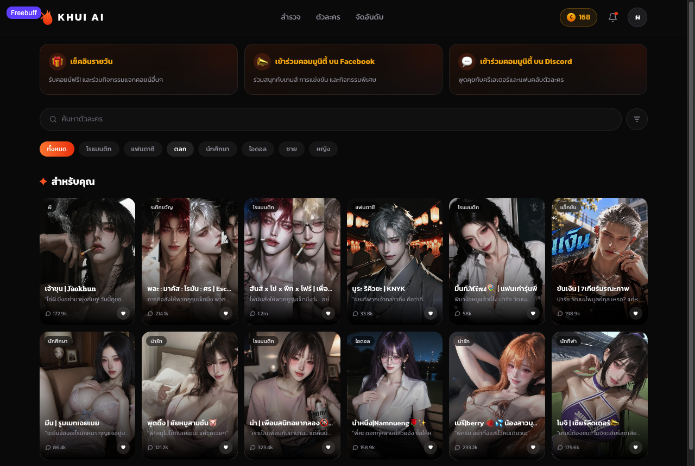
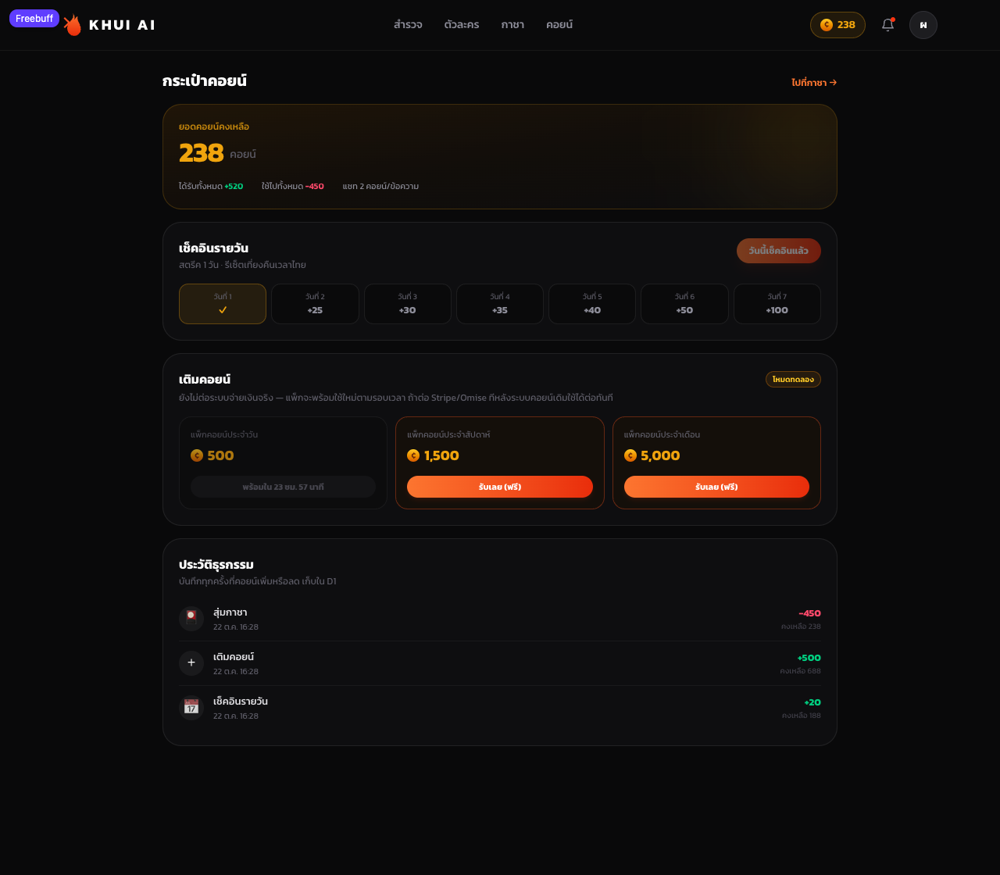
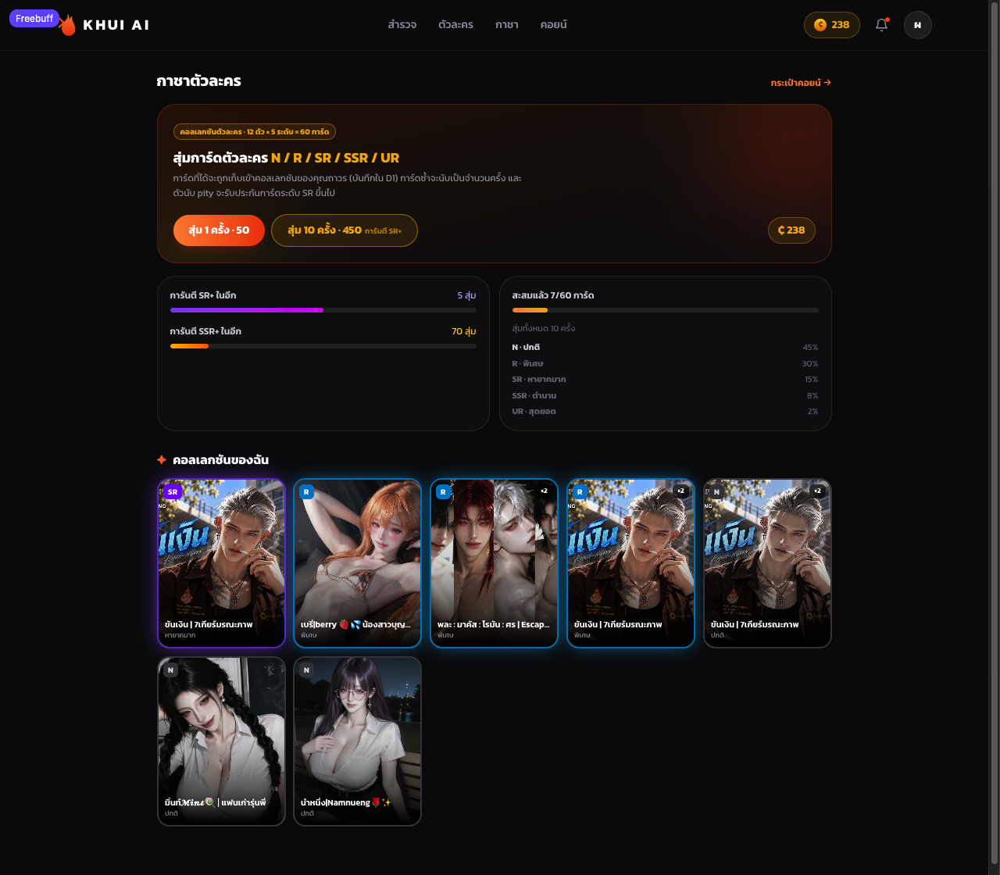
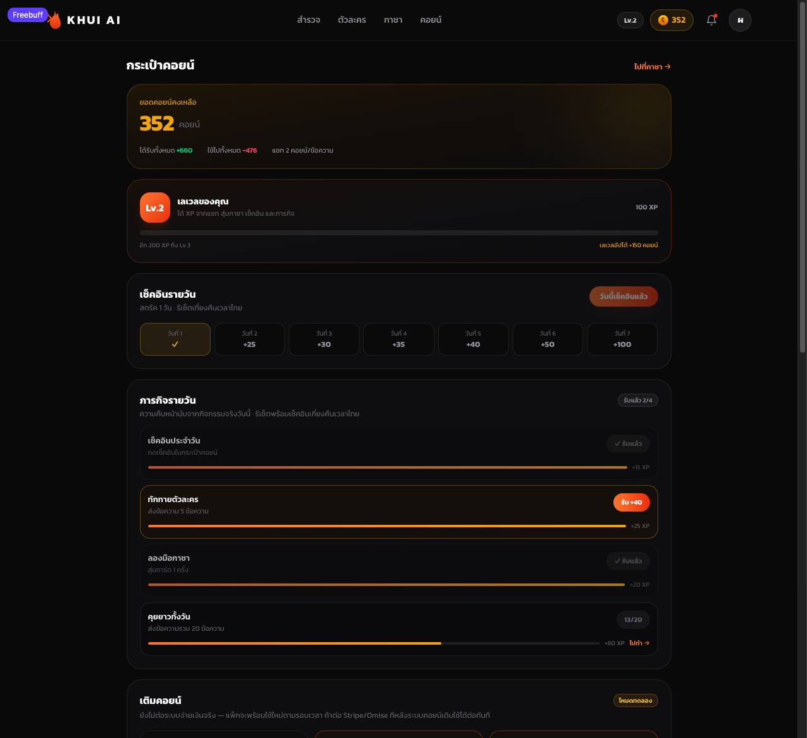
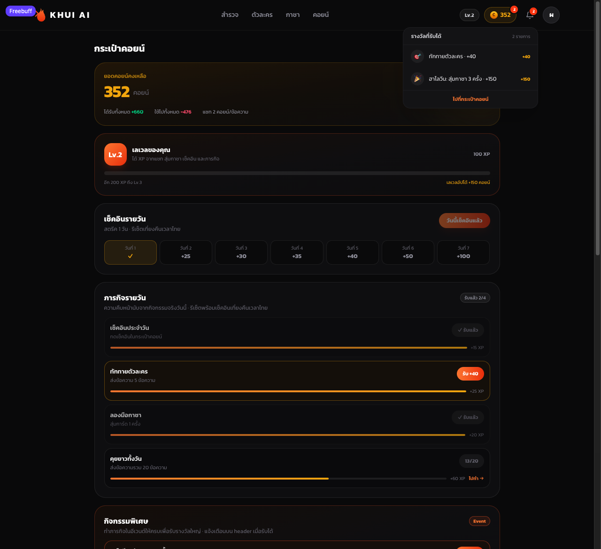
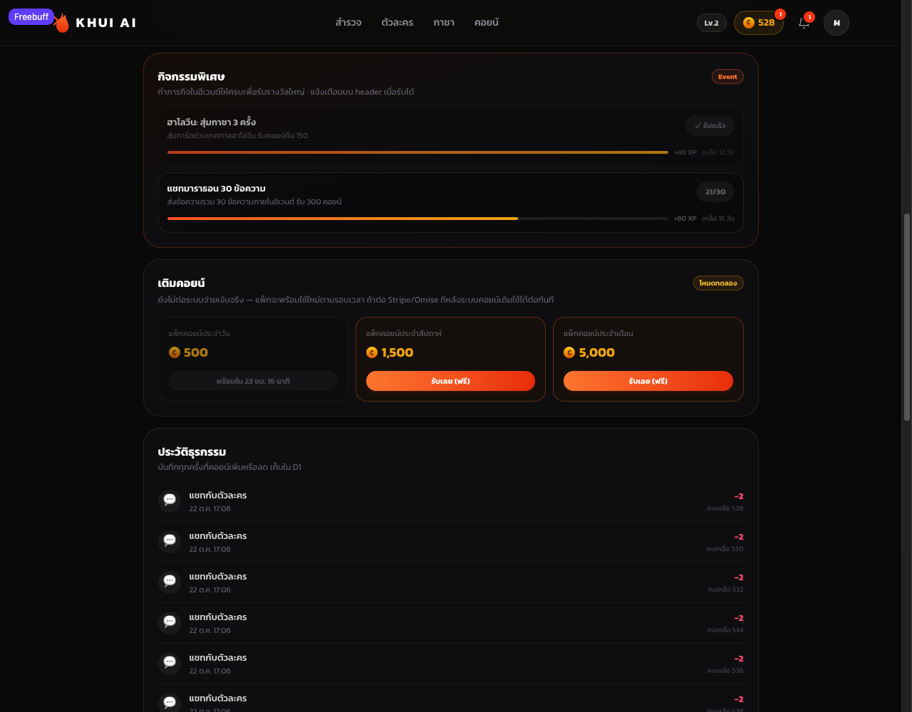

# Khui AI Clone — แชทบอทตัวละครภาษาไทย

> โปรเจกต์ศึกษา/ทดลองสร้าง clone ของ [khuiai.com](https://www.khuiai.com/th) — **ไม่ได้มีความเกี่ยวข้องกับเจ้าของบริการ**
> ข้อมูลตัวละครและรูปภาพเป็นลิขสิทธิ์ของเจ้าของเดิม (hotlink จาก CDN ของเขา) ใช้เพื่อการเรียนรู้เท่านั้น

เว็บแอปแชทกับตัวละครสมมติภาษาไทย พร้อมระบบสมาชิก ระบบคอยน์ กาชาการ์ด ภารกิจรายวัน เลเวล และอีเวนต์
frontend เป็น SPA (React + Vite) ทั้งหมด ส่วน backend เป็น Cloudflare Worker ตัวเดียวที่เสิร์ฟ static assets และ API โดยเก็บข้อมูลใน D1 (SQLite)

**Live (preview):** https://site-41c7ca1fcc6241fd9a641857cd57fcae.freebuff.page

| หน้าแรก | กระเป๋าคอยน์ |
| --- | --- |
|  |  |

| กาชา | ภารกิจ & เลเวล |
| --- | --- |
|  |  |

| แจ้งเตือน | อีเวนต์ |
| --- | --- |
|  |  |

---

## สารบัญ

- [ฟีเจอร์](#ฟีเจอร์)
- [เทคโนโลยี](#เทคโนโลยี)
- [สถาปัตยกรรม](#สถาปัตยกรรม)
- [โครงสร้างโปรเจกต์](#โครงสร้างโปรเจกต์)
- [เริ่มใช้งาน](#เริ่มใช้งาน)
- [การ deploy](#การ-deploy)
- [ตั้งค่า Google / Facebook Login](#ตั้งค่า-google--facebook-login)
- [Data model](#data-model)
- [เศรษฐกิจคอยน์](#เศรษฐกิจคอยน์)
- [เลเวล & ภารกิจรายวัน](#เลเวล--ภารกิจรายวัน)
- [กาชา](#กาชา)
- [อีเวนต์ & การแจ้งเตือน](#อีเวนต์--การแจ้งเตือน)
- [API](#api)
- [ความปลอดภัย](#ความปลอดภัย)
- [การทดสอบ](#การทดสอบ)
- [แผนงานต่อไป](#แผนงานต่อไป)
- [ข้อจำกัด](#ข้อจำกัด)

---

## ฟีเจอร์

**ตัวละคร & แชท**

- หน้าแรกแบบ khuiai: promo strip, ช่องค้นหา, ชิปฟิลเตอร์, กริดตัวละคร, bottom nav บนมือถือ
- ตัวละคร 12 ตัว พร้อมคำโปรย แท็ก และจำนวนแชท (ข้อมูล/รูปดึงจาก khuiai.com)
- แชทกับตัวละคร: ประวัติเก็บใน D1, ตัด **2 คอยน์/ข้อความ**, กันข้อความว่าง/ยาวเกิน 2,000 ตัวอักษร
- คำตอบเป็นข้อความจำลอง (mock) — ยังไม่ได้ต่อ LLM

**สมาชิก**

- สมัคร/เข้าสู่ระบบด้วยอีเมล + รหัสผ่าน (PBKDF2-SHA256 100,000 รอบ)
- Google / Facebook OAuth พร้อมใช้ในโค้ด แต่ต้องใส่ OAuth app ของคุณเอง ([AUTH-SETUP.md](AUTH-SETUP.md))
- Session เป็น HttpOnly + Secure + SameSite=Lax cookie อายุ 30 วัน (เก็บเฉพาะ SHA-256 ของ token)

**คอยน์**

- Ledger ทุกธุรกรรมในตาราง `coin_tx` (`delta`, `kind`, `balance_after`) — ประวัติตรวจย้อนได้จริง
- เช็คอินรายวัน 7 วันวนรอบ (+20 … +100) รีเซ็ตตามเวลาไทย
- เติมคอยน์แบบเดโม 3 แพ็ก (คูลดาวน์ 24 ชม. / 7 วัน / 30 วัน)
- กันยอดติดลบด้วย `UPDATE ... WHERE coins >= ?` + ตรวจ `meta.changes`
- ประวัติธุรกรรม + สถิติรับ/ใช้ทั้งหมดในหน้า `/wallet`

**เลเวล & ภารกิจ**

- XP จากแชท สุ่มกาชา เช็คอิน และภารกิจ → เลเวล 1–99 พร้อมโบนัสคอยน์เมื่ออัปเลเวล
- ภารกิจรายวัน 4 อย่าง ความคืบหน้าคำนวณจากกิจกรรมจริง (ไม่ต้องมีตัวนับแยก)

**กาชา**

- การ์ด 60 ใบ = ตัวละคร 12 × ระดับ 5 (N/R/SR/SSR/UR)
- สุ่ม 1 ครั้ง 50 คอยน์ หรือ 10 ครั้ง 450 คอยน์ (ถูกลง 10%)
- Pity: การันตี SR+ ทุก 10 สุ่ม, SSR+ ทุก 80 สุ่ม — โชว์หลอดความคืบหน้า
- อนิเมชันเปิดการ์ดทีละใบ, ป้าย NEW, คอลเลกชันถาวรพร้อมจำนวนการ์ดซ้ำ

**อีเวนต์ & แจ้งเตือน**

- อีเวนต์ช่วงเวลาจำกัด (ความคืบหน้าคำนวณจากกิจกรรมจริงในช่วงวันที่อีเวนต์)
- Badge บนปุ่มคอยน์ + กระดิ่ง + จุดบนแท็บมือถือ เมื่อมีรางวัลรับได้ (เช็คอิน/ภารกิจ/อีเวนต์)
- Dropdown แจ้งเตือนบน header พร้อมลิงก์ไปหน้ารับรางวัล
- ทุกอย่างมาจากฟังก์ชัน `rewardState()` ตัวเดียว จึงไม่มีทางที่ badge กับหน้ากระเป๋าไม่ตรงกัน

**UI/UX**

- ธีมดำ #08080A + ส้ม, ฟอนต์ Kanit, รองรับมือถือเต็มรูปแบบ (bottom nav, sticky header)
- Toast แจ้งผลการกระทำ, สถานะ disabled/loading ครบทุกปุ่ม

---

## เทคโนโลยี

| ส่วน | เทคโนโลยี |
| --- | --- |
| Frontend | React 19, TypeScript, Vite 8, React Router 7, Tailwind CSS 4 |
| Backend | Cloudflare Worker (ES module) + D1 (SQLite) |
| Auth | Web Crypto (PBKDF2 + SHA-256), HttpOnly cookie session |
| Deploy | Freebuff Sites (Worker + static assets manifest) |
| Lint | Oxlint |

ไม่มี dependency ฝั่ง server เลย — Worker ใช้ Web API ทั้งหมด (`crypto.subtle`, `fetch`, `Response`)

---

## สถาปัตยกรรม

```
┌─────────────────────────────┐
│  Browser (SPA)              │
│  React 19 + Vite build      │
│  /  /characters  /chat/:id  │
│  /wallet  /gacha  /login    │
└──────────────┬──────────────┘
               │ fetch (same-origin, cookie session)
┌──────────────▼──────────────┐
│  Cloudflare Worker          │
│  ├─ /api/*  → JSON API      │
│  └─ อื่นๆ   → env.ASSETS    │  (SPA fallback → index.html)
└──────────────┬──────────────┘
               │
      ┌────────▼────────┐
      │  D1 (SQLite)    │
      │  users, sessions│
      │  messages       │
      │  coin_tx …      │
      └─────────────────┘
```

- Worker สร้างตารางทั้งหมดเองด้วย `CREATE TABLE IF NOT EXISTS` ตอน request แรก (ไม่มี migration tool)
- Schema ถูก cache ต่อ isolate (`schemaPromise`) เพื่อไม่ให้รันซ้ำทุก request

---

## โครงสร้างโปรเจกต์

```
.
├── deploy/
│   ├── worker.js          # Worker ทั้งหมด: auth, coins, quests, levels, gacha, events, chat
│   └── manifest.json      # manifest สำหรับ deploy (entrypoint + assets + SPA)
├── docs/screenshots/      # รูปประกอบ README
├── public/                # favicon, icons
├── src/
│   ├── components/
│   │   ├── Header.tsx     # โลโก้, nav, badge คอยน์, กระดิ่งแจ้งเตือน, เมนูบัญชี
│   │   └── MobileNav.tsx  # bottom nav + จุดแจ้งเตือน
│   ├── data/characters.ts # ข้อมูลตัวละคร 12 ตัว (id ต้องตรงกับ CHAR_IDS ใน worker)
│   ├── lib/
│   │   ├── api.ts         # fetch helper + format coins/เวลา
│   │   ├── auth.tsx       # AuthProvider / useAuth
│   │   └── notifications.tsx # NotificationsProvider (badge รางวัลที่รับได้)
│   ├── pages/
│   │   ├── Home.tsx       # หน้าแรก + ค้นหา + ฟิลเตอร์
│   │   ├── Characters.tsx # รวมตัวละคร
│   │   ├── Chat.tsx       # แชท (หักคอยน์)
│   │   ├── Wallet.tsx     # คอยน์, เช็คอิน, เลเวล, ภารกิจ, อีเวนต์, เติม, ประวัติ
│   │   ├── Gacha.tsx      # สุ่มการ์ด + pity + คอลเลกชัน
│   │   └── Auth.tsx       # login/signup + ปุ่ม Google/Facebook
│   ├── App.tsx            # routes + providers
│   └── index.css          # Tailwind + ฟอนต์ + keyframes
├── AUTH-SETUP.md          # วิธีตั้งค่า Google/Facebook OAuth
└── README.md
```

---

## เริ่มใช้งาน

ต้องมี Node.js 20+ (พัฒนาและทดสอบด้วย Node 26)

```bash
npm install
npm run dev      # Vite dev server — /api/* จะ 404 เพราะยังไม่มี Worker
npm run build    # tsc -b && vite build → dist/
npm run lint     # oxlint
```

> `npm run dev` ใช้ดู UI ได้ แต่ฟีเจอร์ทั้งหมดต้องมี Worker + D1 จึงจะทำงาน
> วิธีทดสอบแบบเต็มคือ build แล้ว deploy ขึ้น Sites (หรือรัน Worker ด้วย wrangler ถ้าเพิ่ม `wrangler.toml` เอง)

## การ deploy

โปรเจกต์นี้ deploy ผ่าน **Freebuff Sites** โดยใช้ `deploy/manifest.json`:

```json
{
  "entrypoint": "worker.js",
  "compatibilityDate": "2024-09-23",
  "modules": [{ "name": "worker.js", "type": "esm", "path": "./worker.js" }],
  "assetsDirectory": "../dist",
  "spa": true
}
```

ขั้นตอน: `npm run build` → สร้าง/เลือก Sites project → deploy ด้วย manifest นี้
Worker จะผูก D1 ให้อัตโนมัติผ่าน binding `env.DB`

> ถ้าจะย้ายไป Cloudflare ตรง ๆ ต้องเพิ่ม `wrangler.toml` ที่ประกาศ `d1_databases` + assets binding เอง

---

## ตั้งค่า Google / Facebook Login

ปุ่มทั้งสองมีอยู่จริงและเรียก `/api/auth/oauth/:provider` แต่จะตอบ `503` จนกว่าจะใส่ secrets:

| Secret | ใช้ทำอะไร |
| --- | --- |
| `GOOGLE_CLIENT_ID` / `GOOGLE_CLIENT_SECRET` | Google OAuth 2.0 (scope `openid email profile`) |
| `FACEBOOK_APP_ID` / `FACEBOOK_APP_SECRET` | Facebook Login (scope `email,public_profile`) |

Redirect URI ต้องตรงเป๊ะ: `https://<โดเมนของคุณ>/api/auth/callback/google` (และ `/facebook`)
รายละเอียดทั้งหมดอยู่ใน [AUTH-SETUP.md](AUTH-SETUP.md)

---

## Data model

| ตาราง | เก็บอะไร |
| --- | --- |
| `users` | บัญชี, hash รหัสผ่าน (NULL สำหรับ OAuth), ยอดคอยน์, avatar |
| `sessions` | SHA-256 ของ session token + วันหมดอายุ |
| `oauth_states` | state กัน CSRF ของ OAuth (ใช้ครั้งเดียวแล้วลบ) |
| `messages` | ประวัติแชท (`role` = user/assistant) |
| `coin_tx` | **ledger** ทุกการเปลี่ยนแปลงคอยน์ + ยอดคงเหลือหลังทำรายการ |
| `checkins` | เช็คอินรายวัน + สตรีค (PK `user_id, day`) |
| `progress` | XP และเลเวลสะสม |
| `quest_claims` | ภารกิจที่รับรางวัลแล้ว (PK `user_id, day, quest_id`) |
| `event_claims` | อีเวนต์ที่รับรางวัลแล้ว (PK `user_id, event_id`) |
| `gacha_state` | ตัวนับ pity + จำนวนสุ่มทั้งหมด |
| `gacha_pulls` | log การสุ่มทุกครั้ง (ใช้คำนวณความคืบหน้าอีเวนต์) |
| `user_cards` | คอลเลกชันการ์ด + จำนวนครั้งที่ได้ซ้ำ |

วันทั้งหมดคิดตามเวลาไทย (UTC+7): `dayKey()` + `dayStart()`

---

## เศรษฐกิจคอยน์

| รายการ | จำนวน | หมายเหตุ |
| --- | --- | --- |
| โบนัสสมัครสมาชิก | +170 | เขียน ledger ตอน signup |
| แชท 1 ข้อความ | −2 | บันทึกข้อความ + ตัดคอยน์ใน batch เดียว |
| เช็คอินรายวัน | +20 / 25 / 30 / 35 / 40 / 50 / 100 | วนรอบ 7 วัน |
| เติมคอยน์ (เดโม) | +500 / +1,500 / +5,000 | คูลดาวน์ 24 ชม. / 7 วัน / 30 วัน |
| สุ่มกาชา | −50 (1) / −450 (10) | 10 ครั้งถูกลง 10% |
| ภารกิจรายวัน | +20 / +40 / +20 / +120 | รวม 200/วัน |
| อีเวนต์ | +150 / +300 | ตามเงื่อนไขอีเวนต์ |
| เลเวลอัป | `50 + 50 × (L−1)` | เช่น Lv.2 = 100, Lv.3 = 150 |

**การเติมคอยน์เป็นโหมดเดโม** — ยังไม่มีการชำระเงินจริง
เมื่อจะต่อ Stripe/Omise ให้เปลี่ยนแค่ handler `POST /api/wallet/topup` เป็นการสร้าง checkout session + webhook ที่เรียกฟังก์ชันเติมเดียวกัน ส่วน ledger/UI/ประวัติไม่ต้องแก้

---

## เลเวล & ภารกิจรายวัน

```
xpForLevel(L) = 50 × (L−1) × L        → Lv.2 = 100, Lv.3 = 300, Lv.4 = 600, Lv.5 = 1,000 (สูงสุด 99)
levelBonus(L) = 50 + 50 × (L−1)
```

| แหล่ง XP | จำนวน |
| --- | --- |
| แชท | 5 / ข้อความ |
| สุ่มกาชา | 10 / ครั้ง |
| เช็คอิน | 15 |
| ภารกิจ | 15–60 |
| อีเวนต์ | 40–80 |

| ภารกิจ | เงื่อนไข | รางวัล | XP |
| --- | --- | --- | --- |
| เช็คอินประจำวัน | เช็คอิน 1 ครั้ง | +20 | 15 |
| ทักทายตัวละคร | ส่งข้อความ 5 ข้อความ | +40 | 25 |
| ลองมือกาชา | สุ่มการ์ด 1 ครั้ง | +20 | 20 |
| คุยยาวทั้งวัน | ส่งข้อความ 20 ข้อความ | +120 | 60 |

**ความคืบหน้าไม่ได้เก็บแยก** — คำนวณจากตารางที่มีอยู่ (`checkins`, `messages`, `gacha_pulls`) เฉพาะวันนั้น
จึงไม่มีทางเพี้ยนหรือนับซ้ำ ส่วนการรับรางวัลกันซ้ำด้วย primary key ใน `quest_claims`

---

## กาชา

การ์ด 1 ใบ = ตัวละคร 1 ตัว × ระดับ 1 ระดับ → 12 × 5 = **60 ใบ** (คีย์ `characterId:rarity`)

| ระดับ | โอกาส | ความหมาย |
| --- | --- | --- |
| N | 45% | ปกติ |
| R | 30% | พิเศษ |
| SR | 15% | หายากมาก |
| SSR | 8% | ตำนาน |
| UR | 2% | สุดยอด |

- **Pity SR**: สุ่มครบ 10 ครั้งโดยไม่ได้ SR+ → ครั้งถัดไปบังคับ SR+
- **Pity SSR**: ครบ 80 ครั้ง → บังคับ SSR+
- **10 สุ่ม**: การันตี SR+ อย่างน้อย 1 ใบ (ในทางปฏิบัติตัวนับ pity บังคับให้ครั้งที่ 10 ของรอบเป็น SR+ อยู่แล้ว)
- การ์ดซ้ำในรอบเดียวกันนับสะสมถูกต้อง (`count = count + excluded.count`)
- อัตราจริงยืนยันด้วย simulation 200,000 สุ่ม: N 44.07% · R 29.45% · SR 15.80% · SSR 8.58% · UR 2.11%

---

## อีเวนต์ & การแจ้งเตือน

อีเวนต์เป็นข้อมูลในตัวแปร `EVENTS` ของ Worker (`id`, `kind`, `goal`, `reward`, `xp`, `start`, `end`)
ความคืบหน้าคำนวณจากกิจกรรมจริงในช่วงวันที่อีเวนต์ — เหมือนภารกิจ ไม่มีตัวนับแยก
รับรางวัลได้ครั้งเดียวต่ออีเวนต์ และต้องอยู่ในช่วงเวลาอีเวนต์

| อีเวนต์ | เงื่อนไข | ช่วงเวลา | รางวัล |
| --- | --- | --- | --- |
| `halloween-gacha` | สุ่มกาชา 3 ครั้ง | 20 ต.ค. – 2 พ.ย. 2026 | +150 คอยน์, +40 XP |
| `chat-marathon` | ส่งข้อความ 30 ข้อความ | 20 ต.ค. – 5 พ.ย. 2026 | +300 คอยน์, +80 XP |

**แจ้งเตือน** (`GET /api/notifications`) รวมทุกอย่างที่ "รับได้ตอนนี้": เช็คอินที่ยังไม่กด, ภารกิจที่ทำครบ, อีเวนต์ที่ทำครบ
→ ใช้เป็น badge บนปุ่มคอยน์ / กระดิ่ง / แท็บมือถือ และเป็น dropdown บน header
หลังรับรางวัล หน้าเว็บเรียก `refresh()` ของ `NotificationsProvider` ทำให้จุดแดงหายทันที

---

## API

ทั้งหมดอยู่ใต้ `/api` และคืน JSON (`cache-control: no-store`)

**Auth**

| Method | Path | หมายเหตุ |
| --- | --- | --- |
| POST | `/api/auth/signup` | `{ email, name, password }` → 201 + cookie |
| POST | `/api/auth/login` | `{ email, password }` |
| POST | `/api/auth/logout` | ลบ session |
| GET | `/api/auth/me` | ผู้ใช้ปัจจุบัน (null ถ้าไม่ล็อกอิน) |
| GET | `/api/auth/providers` | ระบุว่า Google/Facebook ถูกตั้งค่าแล้วหรือยัง |
| GET | `/api/auth/oauth/:provider` | เริ่ม OAuth (503 ถ้ายังไม่ตั้งค่า) |
| GET | `/api/auth/callback/:provider` | callback → สร้าง session แล้ว redirect |

**Coin / rewards**

| Method | Path | หมายเหตุ |
| --- | --- | --- |
| GET | `/api/wallet` | ยอดคอยน์, เช็คอิน, level, ภารกิจ, อีเวนต์, แพ็กเติม, สถิติ |
| POST | `/api/wallet/checkin` | รับคอยน์รายวัน (409 ถ้าเช็คอินแล้ว) |
| POST | `/api/wallet/topup` | `{ pack: "daily" \| "weekly" \| "monthly" }` (429 ถ้าติดคูลดาวน์) |
| POST | `/api/wallet/quests/claim` | `{ id }` (400 ยังไม่เสร็จ / 409 รับแล้ว) |
| POST | `/api/wallet/events/claim` | `{ id }` (400 ยังไม่ครบหรือหมดเวลา / 409 รับแล้ว) |
| GET | `/api/wallet/transactions?limit=` | ประวัติ ledger (สูงสุด 100) |
| GET | `/api/notifications` | `{ count, items[] }` สำหรับ badge (ไม่ล็อกอิน → count 0) |

**Gacha / chat**

| Method | Path | หมายเหตุ |
| --- | --- | --- |
| GET | `/api/gacha` | pity, โอกาส, สถิติ, คอลเลกชัน |
| POST | `/api/gacha/pull` | `{ count: 1 \| 10 }` (402 ถ้าคอยน์ไม่พอ) |
| GET | `/api/chat/:characterId` | ประวัติ 200 ข้อความล่าสุด |
| POST | `/api/chat/:characterId` | `{ content }` → คำตอบ + ยอดคอยน์ใหม่ (402 ถ้าคอยน์ไม่พอ) |

---

## ความปลอดภัย

- รหัสผ่าน hash ด้วย **PBKDF2-SHA256 100,000 รอบ** + salt 16 ไบต์ (Workers จำกัด iteration ที่ 100k)
- Session token สุ่ม 32 ไบต์ เก็บใน DB เฉพาะ **SHA-256** — ถ้า DB รั่วก็ปลอม session ไม่ได้
- Cookie: `HttpOnly; Secure; SameSite=Lax; Max-Age=30d`
- ทุก endpoint ที่แตะข้อมูลผู้ใช้ดึง `user_id` จาก session เท่านั้น (ไม่รับจาก client) และ query กรองด้วย `user_id` ทุกครั้ง
- OAuth ใช้ `state` สุ่มเก็บใน DB และลบหลังใช้ (กัน replay/CSRF)
- การตัดคอยน์ทุกจุดอยู่ใน `DB.batch()` แบบ transactional + เงื่อนไข `coins >= ?` กันยอดติดลบเมื่อกดพร้อมกัน
- ไม่มี secret ฝั่ง client — OAuth client secret อยู่ที่ env ของ Worker เท่านั้น
- คืน `no-store` ทุก response ของ API เพื่อไม่ให้ cache ข้อมูลผู้ใช้

**ยังไม่มี:** rate limiting ต่อ IP, email verification, password reset, 2FA, audit log ผู้ดูแล

---

## การทดสอบ

ทดสอบกับ deployment จริง (ไม่ใช่ mock) ด้วยสคริปต์ E2E ยิง API ตรง + ตรวจในเบราว์เซอร์:

- **Auth**: signup → cookie → `/api/auth/me` → logout → login ใหม่ (ประวัติ/คอยน์ยังอยู่)
- **คอยน์**: เช็คอิน 168 → 188, เติม +500, สุ่ม −450, ledger ตรงทุกแถวและ `balance_after` ต่อเนื่อง
- **เส้นทาง error**: 401 (ไม่ล็อกอิน), 402 (คอยน์ไม่พอ), 409 (รับซ้ำ/เช็คอินซ้ำ), 429 (แพ็กติดคูลดาวน์)
- **ภารกิจ/เลเวล**: 20/20 checks — XP จากทุกแหล่ง, claim ก่อนครบ 400, claim ซ้ำ 409, เลเวลอัปที่ 100 XP พร้อมโบนัส +100 และ ledger `levelup`
- **กาชา**: สุ่มเดี่ยว 60 ครั้ง (pity ยิง 2 ครั้ง, ไม่มีหน้าต่าง 10 ครั้งไหนหลุด SR+), 10 สุ่ม 8 รอบ (ทุกครั้งมี SR+), invariant ผลรวมการ์ด 60 → 70
- **อีเวนต์/แจ้งเตือน**: 15/15 checks — badge ตรงกับรางวัลจริง, รับอีเวนต์ +150, รับซ้ำ 409, หมดเวลา/ไม่ครบ 400
- **UI**: เดสก์ท็อป + มือถือ (bottom nav, badge), dropdown เปิด/ปิดด้วยคลิกนอกและ Escape, ไม่มี console error
- `tsc -b` + `vite build` ผ่าน, `oxlint` 0 error

> ยังไม่มีชุดเทสต์อัตโนมัติใน repo (สคริปต์ E2E ที่ใช้ทดสอบเป็นแบบครั้งเดียว) — อยู่ในแผนงาน

---

## แผนงานต่อไป

**ใกล้ที่สุด**

- [ ] **ต่อระบบจ่ายเงินจริง** (Stripe หรือ Omise/Opn) — เปลี่ยน `POST /api/wallet/topup` เป็น checkout session + webhook ที่เรียกฟังก์ชันเติมเดิม
- [ ] **ต่อ LLM จริง** ให้ตัวละครตอบตาม persona (streaming, จำกัด token ต่อข้อความ, fallback เมื่อผู้ให้บริการล่ม)
- [ ] **ย้าย `EVENTS` ไปเก็บใน D1 + หน้าแอดมิน** เพื่อตั้ง/ปิดแคมเปญได้โดยไม่ต้อง deploy
- [ ] **รับรางวัลได้จาก dropdown แจ้งเตือนโดยตรง** ลดขั้นตอนการกด

**ถัดไป**

- [ ] ภารกิจรายสัปดาห์ + กระดานจัดอันดับจาก XP
- [ ] ภาพการ์ดเฉพาะแต่ละระดับ + หน้ารายละเอียดการ์ด/โปรไฟล์ตัวละคร
- [ ] แจ้งเตือนแบบ realtime (Durable Object/WebSocket) หรือ Web Push
- [ ] เก็บรูปตัวละครไว้ใน R2 ของเราเอง (เลิก hotlink CDN เจ้าอื่น)
- [ ] rate limiting, email verification, password reset, 2FA
- [ ] ชุดเทสต์อัตโนมัติ (Vitest + integration กับ workerd) และ GitHub Actions CI

**ระยะยาว**

- [ ] deploy production + custom domain
- [ ] โหมด PWA/มือถือ, ธีมสว่าง, การเข้าถึง (a11y)
- [ ] ระบบรายงานเนื้อหา/ moderation และนโยบายความเป็นส่วนตัวสำหรับแชท
- [ ] ระบบเพื่อน/แชร์การ์ด/แลกการ์ดระหว่างผู้ใช้

---

## ข้อจำกัด

- **คำตอบของตัวละครเป็นข้อความจำลอง** ไม่ได้ต่อ LLM จริง
- **รูปตัวละคร hotlink จาก CDN ของ khuiai** ถ้าเขาเปลี่ยน path รูปจะหาย
- **การเติมคอยน์เป็นเดโม** ยังไม่มีการชำระเงินจริง
- **อีเวนต์ hardcode ใน Worker** เพิ่ม/แก้ต้อง deploy ใหม่
- Badge แจ้งเตือนอัปเดตตอนเปลี่ยนหน้า/หลังทำแอ็กชัน ไม่ใช่ realtime
- ยังไม่ deploy production (preview เปิดสาธารณะอยู่แล้ว)
- โปรเจกต์นี้ไม่มีส่วนเกี่ยวข้องกับ khuiai.com — ข้อมูลและรูปภาพเป็นลิขสิทธิ์ของเจ้าของเดิม ใช้เพื่อการศึกษาเท่านั้น
